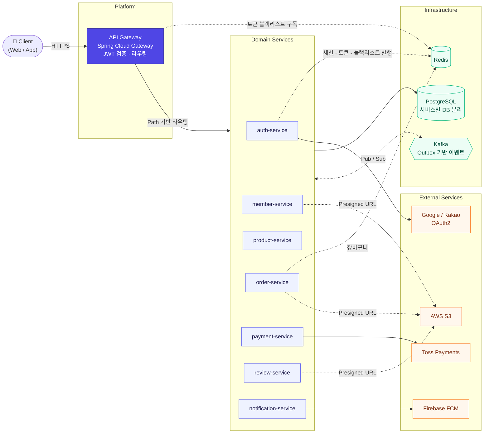

# 🐾 골라주개냥 서버 (golajugaenyang-server)

> **우리 아이에게 꼭 맞는 선택, 맞춤형 펫 커머스 플랫폼 골라주개냥**의 백엔드 서버


골라주개냥은 반려동물의 종·품종·알레르기·건강 관심사를 기반으로 상품과 리뷰를 맞춤 추천하고, 타임딜·주문·결제까지 처리하는 커머스 서비스입니다.
7개의 도메인 서비스와 API Gateway로 구성된 MSA 모노레포로 구성하였습니다.

-  🗓️ MVP 개발 기간: `2026.09.04 ~ 2026.10.02`

<br/>

## 👥 Member

| 노여진 | 문시원 |
| :---: | :---: |
| 인증 · 회원 · 리뷰 · 알림 | 팀장 / 상품 · 주문 · 결제 |
| [@jinjinjala-ish](https://github.com/jinjinjala-ish) | [@muncool39](https://github.com/muncool39) |

<br/>


## 🏗️ 아키텍처



| 원칙 | 내용 |
| --- | --- |
| **서비스 간 통신** | 서비스 간 메서드 직접 호출을 금지합니다. 즉시 응답이 필요한 조회·예약은 **OpenFeign**(동기), 상태 변경 전파는 **Kafka**(비동기)를 사용합니다. |
| **DB Service** | 서비스마다 PostgreSQL DB를 완전히 분리하고, 다른 서비스 데이터는 API나 이벤트로만 접근합니다. |
| **이벤트 발행 원자성** | 도메인 변경과 이벤트를 같은 트랜잭션에서 Outbox 테이블에 기록하고, 폴러가 Kafka로 발행합니다. |
| **인증 위임** | Gateway가 JWT를 검증한 뒤 클레임을 헤더로 전달하고, 각 서비스는 내부 시크릿으로 Gateway 경유 요청만 신뢰합니다. |
| **계층 구조** | 서비스 내부는 헥사고날 아키텍처(`adapter/in` → `application/port` → `domain` ← `adapter/out`)를 따릅니다. |

<br/>

## 📨 이벤트 맵

| 토픽 | Producer | Consumer (group) | 처리 |
| --- | --- | --- | --- |
| `payment.completed` | payment | product (`inventory-consumer`) | 재고 `CONFIRM` |
| | | order (`order-status-consumer`) | 주문 `PAID` |
| `payment.failed` | payment | product (`inventory-consumer`) | 재고 `RELEASE` |
| | | order (`order-status-consumer`) | 주문 취소 |
| `order.item-cancelled` | order | product (`inventory-consumer`) | 재고 `RELEASE` |
| | | payment (`refund-consumer`) | Toss 결제 취소 |
| `order.item-returned` | order | product (`inventory-consumer`) | 재고 `RESTORE` |

order·payment 컨슈머는 3회 재시도 후 `<topic>.DLT`로 메시지를 격리합니다.
<!-- TODO: product 컨슈머에도 DLT 설정 추가 후 "모든 컨슈머"로 수정 -->

<br/>

## 📌 서비스별 기능

| 서비스 | 주요 기능 |
| --- | --- |
| **auth** | OAuth2 소셜 로그인(Google/Kakao), JWT 발급(JWKS 공개), Refresh Token rotation, 휴대폰 인증, 즉시 로그아웃 |
| **member** | 회원·배송지·약관 동의, 반려동물 다중 등록(종/품종/체중/중성화/건강 관심사/알레르기 프로필) |
| **product** | 카테고리·조건별 검색(QueryDSL, 커서 페이지네이션), 상품 상세, 타임딜, 재고 예약·확정·해제·복원 |
| **order** | Redis 장바구니(Lua 스크립트로 원자적 수량 변경), 주문 생성·조회·취소, 반품·교환 클레임 |
| **payment** | Toss Payments 결제 요청·승인·취소 |
| **review** | 맞춤보기 개인화 필터, 품종 다중 선택, 리뷰 이미지 업로드, 구매 후 반응 체크 |
| **notification** | FCM 푸시 토큰 관리, 카테고리별 구독, 공지 발송, 타임딜 알림 |

<br/>

## 🎯 핵심 기술
### 1. 재고 정합성
- **상태 자동 전이:** 지정된 시각을 기준으로 타임딜 상품의 상태가 자동으로 오픈/마감되도록 스케줄링 및 이벤트 처리를 적용했습니다.
- **안전한 주문/결제:** 대량의 트래픽이 몰리는 상황에서도 재고 동시성 문제를 제어하고, 결제 승인/실패/완료 이벤트를 비동기로 안전하게 처리합니다.

### 2. 이벤트 신뢰성: Transactional Outbox + Dead Letter Topic

- 도메인 변경과 Outbox 기록을 같은 트랜잭션으로 커밋해 이벤트 유실과 유령 이벤트를 막습니다.
- 폴러가 Outbox 행을 조건부 UPDATE로 선점한 뒤 발행합니다. 발행 실패 시 다음 주기에 재시도합니다.
- order·payment 컨슈머는 `DefaultErrorHandler`로 3회 재시도 후 DLT(`<topic>.DLT`)로 격리해, 처리 불가 메시지가 파티션을 막지 않게 합니다.
- 📂 [`OrderOutboxPublisher`](services/order-service/src/main/java/com/golajugaenyang/order/adapter/out/event/OrderOutboxPublisher.java) · 
[`KafkaConsumerConfig`](services/order-service/src/main/java/com/golajugaenyang/order/config/KafkaConsumerConfig.java)

### 3. 강화된 보안 및 인증 처리
- **안전한 JWT 관리:** 게이트웨이 단에서 위조 헤더를 검증하고, 토큰 로테이션 및 재사용 탐지 방어 로직을 적용했습니다.
- **성능을 고려한 즉시 로그아웃:** Redis Pub/Sub과 로컬 캐시(Caffeine)를 조합하여 성능 저하 없이 즉각적인 로그아웃 및 토큰 무효화를 구현했습니다.
- 📂 [`RefreshTokenStore`](services/auth-service/src/main/java/com/golajugaenyang/auth/security/jwt/RefreshTokenStore.java) 
· [`TokenBlacklistCache`](platform/api-gateway/src/main/java/com/golajugaenyang/gateway/security/TokenBlacklistCache.java)

<!-- TODO: 기술 추가 정리 필요 -->

<br/>


## 🛠 기술 스택

| 분류 | 기술 |
| --- | --- |
| **Language / Framework** | Java 25, Spring Boot 4.1.0, Spring Cloud Gateway, Gradle (Groovy DSL) |
| **인증** | Spring Security, OAuth2 Client (Google/Kakao), JWT (JWKS) |
| **통신** | OpenFeign, Apache Kafka (Transactional Outbox, DLT) |
| **Data** | PostgreSQL, Spring Data JPA, QueryDSL, Flyway, Redis, Caffeine |
| **외부 연동** | Toss Payments, Firebase Cloud Messaging, AWS S3 (Presigned URL), CloudFront |
| **테스트** | JUnit 5, Testcontainers |
| **인프라 / 배포** | Docker, Docker Compose, Kubernetes, Jenkins, AWS ECR, GitOps, Trivy |
| **관측성** | Micrometer, Prometheus, OpenTelemetry |


<br/>

## 📦 모듈 구성

| 디렉토리 | 설명 |
| --- | --- |
| `platform/api-gateway` | 라우팅·인증 검증만 담당, 도메인 로직 없음 (`-service` 접미사 미사용) |
| `services/auth-service` | 인증·OAuth2 로그인·JWT 발급 |
| `services/member-service` | 회원·반려동물 |
| `services/product-service` | 상품·재고·타임딜 |
| `services/order-service` | 주문·장바구니·클레임 |
| `services/payment-service` | 결제 |
| `services/review-service` | 리뷰·구매 후 반응 체크 |
| `services/notification-service` | 알림(FCM 푸시·공지) |
| `modules/common-core` | 공통 응답 포맷·예외 처리·유틸. 도메인 로직 금지 |
| `modules/common-event` | Kafka 이벤트 payload/enum만. 서비스 내부 도메인 금지 |
| `modules/common-security` | 인증/인가 공통 로직 |
| `modules/common-jpa` | JPA 공통 설정(Auditing 등) |
| `modules/common-storage` | S3 presigned URL 발급 등 공통 스토리지 로직 |
| `modules/common-test` | Testcontainers 등 통합테스트 지원. `testImplementation`으로만 의존 |

각 서비스의 패키지 구조는 다음과 같습니다.

```
services/{name}-service/src/main/java/.../{name}
├── adapter
│   ├── in          # web(Controller), internal(서비스 간 API), messaging(Kafka Consumer)
│   └── out         # persistence(JPA/QueryDSL), external(Feign/PG), event(Outbox)
├── application     # UseCase 구현, port/in · port/out 인터페이스
├── domain          # 엔티티, 상태 enum, 도메인 규칙
└── config
```

<br/>

## 🗄 데이터베이스

- 서비스마다 독립된 PostgreSQL 데이터베이스를 사용합니다. ([ERD](https://www.erdcloud.com/d/tFD2rewSKvKfDQ9ne))
- 스키마는 Flyway로 버전을 관리합니다(`src/main/resources/db/migration`). JPA는 `ddl-auto: validate`로 엔티티와 스키마의 정합성만 검증합니다.
- `local` 프로필은 기동 시 마이그레이션을 자동 적용하고, 배포(`infra`) 프로필은 Flyway가 꺼져 있어 마이그레이션을 별도로 적용합니다.


<br/>

## 🧪 테스트

```bash
./gradlew test                                   # 전체 테스트
./gradlew :services:product-service:test         # 특정 서비스
```

- 통합 테스트는 **Testcontainers**로 실제 PostgreSQL을 띄워 실행합니다. Docker가 실행 중이어야 합니다.
- 재고 차감, 멱등 처리, 상태 전이처럼 DB 제약에 의존하는 로직은 H2가 아닌 실제 PostgreSQL에서 검증합니다.

<br/>

## 💻 로컬 실행
**요구사항**: Java 25, Docker / Docker Compose (v2.20+)

```bash
# 환경변수 준비
cp .env.example .env
 
# 인프라만 기동 (PostgreSQL, Redis, Kafka, Kafka UI, Prometheus, OTel Collector)
docker compose -f local-infra/docker-compose.yml up -d
 
# a. 특정 서비스만 실행
./gradlew :services:{service-name}:bootRun --args='--spring.profiles.active=local'
 
# b. 전체 서비스를 컨테이너로 실행
./gradlew bootJar --no-daemon
docker compose --profile all up -d --build
```

```bash
# 빌드 및 전체 검증
./gradlew build
```

공통 모듈(`modules/`) 변경은 여러 서비스에 영향을 주므로 전체 빌드로 영향도를 확인합니다.

<br/>

## 📄 문서

- [API 명세서](https://app.notion.com/p/API-3bb9e3e335cc800f89a7da87c1a4cc48?source=copy_link)
- [ERD](https://www.erdcloud.com/d/tFD2rewSKvKfDQ9ne)

<br/>

---

## API Gateway DEV 실행 계약 문서

`platform/api-gateway`는 로컬 프로필의 Route를 그대로 보존하고, Kubernetes DEV에서는
`infra` 프로필과 환경변수로 목적지를 주입한다. Endpoint 값이 누락되면 localhost로
대체하지 않고 애플리케이션 시작이 실패하도록 의도했다.

### 필수 환경변수

| 변수 | DEV 값/주입 방식 | 비밀값 |
| --- | --- | --- |
| `SPRING_PROFILES_ACTIVE` | `infra` | 아니요 |
| `AUTH_SERVICE_URL` | `https://generic-service.auth-service.svc.cluster.local:8443` | 아니요 |
| `MEMBER_SERVICE_URL` | `https://generic-service.member-service.svc.cluster.local:8443` | 아니요 |
| `PRODUCT_SERVICE_URL` | `https://generic-service.product-service.svc.cluster.local:8443` | 아니요 |
| `ORDER_SERVICE_URL` | `https://generic-service.order-service.svc.cluster.local:8443` | 아니요 |
| `PAYMENT_SERVICE_URL` | `https://generic-service.payment-service.svc.cluster.local:8443` | 아니요 |
| `REVIEW_SERVICE_URL` | `https://generic-service.review-service.svc.cluster.local:8443` | 아니요 |
| `NOTIFICATION_SERVICE_URL` | `https://generic-service.notification-service.svc.cluster.local:8443` | 아니요 |
| `JWT_JWKS_URI` | `https://generic-service.auth-service.svc.cluster.local:8443/oauth2/jwks` | 아니요 |
| `REDIS_HOST` | `redis-master.redis.svc.cluster.local` | 아니요 |
| `REDIS_PORT` | `6379` | 아니요 |
| `INTERNAL_GATEWAY_SECRET` | Kubernetes Secret `gateway-secret`의 같은 이름 키 | 예 |

`INTERNAL_GATEWAY_SECRET`의 원본은 기존 서비스들과 같은
`petflow/internal/gateway-secret`을 사용한다. 값 자체를 values나 로그에 기록하지 않는다.

### 연결별 TLS 계약

- ALB → Gateway: HTTP `8080`. 외부 TLS는 Public ALB에서 종료한다. Gateway 서버에
  `SERVER_SSL_*`를 주입하지 않는다.
- Gateway → Backend: HTTPS/mTLS `8443`. Spring Cloud Gateway Netty client가
  `internalmtls` SSL Bundle을 사용한다.
- Gateway → JWKS: Auth의 `/oauth2/jwks`를 별도 WebClient로 조회하며 같은
  `internalmtls` Bundle을 적용한다.
- Gateway → Redis: TLS/mTLS `6379`. 비밀번호/ACL은 현재 DEV Redis에서 사용하지 않는다.

Gateway Pod에는 cert-manager `internal-ca-issuer`가 발급한 client-auth 인증서 Secret을
다음 경로로 읽기 전용 마운트해야 한다.

| 파일 | 용도 |
| --- | --- |
| `/etc/mtls/tls.crt` | Gateway client certificate |
| `/etc/mtls/tls.key` | Gateway private key |
| `/etc/mtls/ca.crt` | Backend/JWKS/Redis 신뢰 CA |

인증서 SAN 검증을 유지하며 trust-all 및 hostname verification 비활성화는 사용하지 않는다.
cert-manager가 Secret을 갱신한 뒤 Gateway outbound client와 Redis/JWKS client의 자동
reload는 보장하지 않으므로 Pod rolling restart로 새 인증서를 로드한다.

### Route

| 외부 경로 | 대상 |
| --- | --- |
| `/api/v1/auths/**` | Auth |
| `/api/auth/oauth2/authorization/**`, `/api/auth/login/oauth2/code/**` | Auth OAuth |
| `/api/v1/members/**`, `/api/v1/pets/**` | Member |
| `/api/v1/products/**`, `/api/v1/time-deals/**` | Product |
| `/api/v1/orders/**`, `/api/v1/carts/**` | Order |
| `/api/v1/payments/**` | Payment |
| `/api/v1/reviews/**` | Review |
| `/api/v1/notifications/**` | Notification |

경로는 Backend Controller와 기존 local Route를 보존하며 `StripPrefix`나
`RewritePath`를 적용하지 않는다. 공개 API와 인증 정책도 이번 변경에서 바꾸지 않는다.

### 빌드

```bash
./gradlew :platform:api-gateway:test --no-daemon
./gradlew :platform:api-gateway:bootJar --no-daemon
docker build -f platform/api-gateway/Dockerfile -t api-gateway:local .
```

Dockerfile은 Jenkins가 먼저 만든 `platform/api-gateway/build/libs/*.jar`를 복사하므로,
단독 `docker build` 전에는 반드시 `bootJar`를 실행한다.

### Docker Compose로 Gateway 재빌드

Gateway Agent와 보안 의존성 수정이 반영된 코드를 받은 뒤 저장소 루트에서 실행한다.
독립적으로 만든 `api-gateway:local` 이미지는 Compose가 관리하는 이미지와 별개이므로,
Dockerfile 변경 후에는 Compose 이미지도 다시 빌드해야 한다.

```bash
./gradlew :platform:api-gateway:test :platform:api-gateway:bootJar --no-daemon
docker compose --profile all build --no-cache api-gateway
docker compose --profile all run --rm --no-deps --entrypoint java api-gateway \
  -javaagent:/app/opentelemetry-javaagent.jar -version
docker compose --profile all up -d --no-deps --force-recreate api-gateway
docker compose logs --tail=100 api-gateway
```

Agent 검사 성공은 JVM이 Agent 파일을 읽고 초기화했다는 뜻이다. Gateway 전체 기동은
마지막 컨테이너 로그와 Health 응답으로 별도 확인한다. `--no-deps`를 사용할 때는
Backend 서비스와 Redis 등 Gateway가 연결할 의존 서비스가 이미 실행 중이어야 한다.

전체 로컬 스택을 처음 시작할 때는 실행 JAR을 모두 만든 뒤 Compose 이미지를 빌드한다.

```bash
./gradlew bootJar --no-daemon
docker compose --profile all up -d --build
```

### 배포 전 선행조건

Jenkins는 `api-gateway` 변경을 감지해 테스트·bootJar·이미지 빌드·스캔 경로까지
지원한다. 그러나 아래 항목은 이 저장소의 이번 변경 범위가 아니며 준비되기 전에
`dev`에 병합하면 실제 배포 단계가 실패할 수 있다.

- ECR `297165773875.dkr.ecr.ap-northeast-2.amazonaws.com/petflow/api-gateway`
- `api-gateway` Namespace, client certificate와 `gateway-secret` 전달
- `gitops-value/values/dev/services/api-gateway/values.yaml`
- Gateway egress 및 Backend/Redis ingress NetworkPolicy
- Public ALB의 `/api/v1`, `/api/auth` Gateway 규칙

